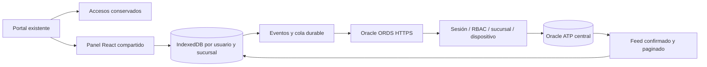

# Arquitectura y alcance de la primera entrega

**Actualización 2026-10-09:** la conexión principal está activa mediante Oracle ORDS. Live Server y GitHub Pages usan la misma API HTTPS. Ver [conexión y mantenimiento](public-api.md). Los pasos Node/TLS siguientes corresponden a la alternativa técnica conservada.

Fecha: 2026-10-08. Fuente: repositorio local y requerimiento adjunto, secciones 53–58.

## Estado inspeccionado

`index.html`, `portal.css`, `brand.css` y `assets/` contienen el portal y la identidad que se conservan. `negocios/{gcobarf,cocteleria,cafeteria}` son copias HTML/CSS/JavaScript del panel Nápoles; no existe Node ni una API propia. `config.js` tiene marcadores de conexión, no un backend instalado. La referencia `../TIENDA-NAPOLES-BCA.COM-main` queda intacta.

La UI de referencia usa navegación lateral, tarjetas de métricas, paneles de mesas, cuentas, inventario, movimientos, ventas, usuarios y marca; estos patrones guían el panel React compartido. Se preservan los accesos actuales y se añade un acceso explícito al nuevo panel. No hay redirección de cobros antiguos a la API nueva.

Supabase resuelve usuarios/PIN, sesiones con token, catálogo, mesas, pedidos, llamados, chat, roles por sección, Storage y Realtime. Apps Script `Code.gs` en la referencia almacena inventario, ventas, líneas, pagos, movimientos y acumulados en Sheets. TC no tiene su URL configurada ni una copia adaptada de ese servicio. El coste existente es coste unitario, no receta. Las ventas individuales tienen borrador local; las mesas necesitan escrituras remotas incluso para cerrar. El outbox usa localStorage, con límites de 2.000 trabajos; no es el motor offline requerido. El SW fuerza red para HTML/JS/CSS; tampoco permite reabrir la aplicación offline.

## Decisiones

Una base Oracle central. Un frontend React con temas y contexto de sucursal. La API PL/SQL publicada en ORDS valida sesión, permiso y pertenencia antes de consultar tablas; las claves del navegador nunca conceden acceso. Oracle es fuente central; Dexie es fuente operacional local. Estado local y evento de outbox se escriben en una transacción IndexedDB. Nunca se mezclan escrituras a Supabase y Oracle para una misma operación financiera.

## Código de esta primera entrega

Monorepo npm: `apps/web`, `apps/api`, `packages/shared`, `packages/sync`, `database`, `scripts`, `infrastructure`, `docs`. React + Vite + Router + Dexie; paquetes PL/SQL y ORDS. Fastify + TypeScript + node-oracledb Thin quedan como alternativa. Dependencias quedan fijadas por `package-lock.json`.

Esta fase entrega modelo/ERD, migraciones base, instalación automatizada, autenticación con sesión revocable y refresh, configuración inicial protegida, lectura de sucursales/catálogo/unidades/ingredientes, alta y edición de productos mediante eventos, cola persistente, idempotencia y conflictos de versión. Incluye un entorno de demostración explícito y pruebas de persistencia, permisos y reintentos del catálogo. No se presenta como un POS completo.

Pendientes de las siguientes fases: recetas/costeo operativo, compras/transferencias, transacciones completas de venta/caja/pagos/devolución, impresión y proveedor fiscal, QR/llamados/chat migrados, dashboard financiero, migración efectiva de registros y endurecimiento/operación productiva. Las tablas de esas áreas son diseño inicial; sus endpoints no se habilitan sin implementar sus invariantes. Los escenarios de 100 ventas y dos cajas offline deberán probarse sobre ese módulo, no simularse con un CRUD de productos.

## Ambigüedades registradas

El portal describe tres negocios y un cuarto reservado; el requerimiento solicita inicialmente un negocio con cuatro sucursales. El seed **de prueba** usa Alliance como business y cuatro locations, con la cuarta inactiva y marca por location. No define la estructura jurídica real: antes de importar se confirma qué marcas son businesses y cuáles son locations. El modelo permite ambas sin otra base.

No se deducen recetas, tasas, margen objetivo, stock negativo, propinas ni políticas fiscales del nombre del negocio. Stock negativo se rechaza por defecto; la decisión comercial se configura después. Los datos de demostración no se importan desde backups Nápoles ni se muestran como ventas reales.

## Referencias técnicas consultadas

- [node-oracledb: conexiones y wallet](https://node-oracledb.readthedocs.io/en/latest/user_guide/connection_handling.html).
- [Dexie: transacciones](https://dexie.org/docs/Dexie/Dexie.transaction%28%29).
- [Fastify: validación](https://fastify.dev/docs/latest/Reference/Validation-and-Serialization/).
