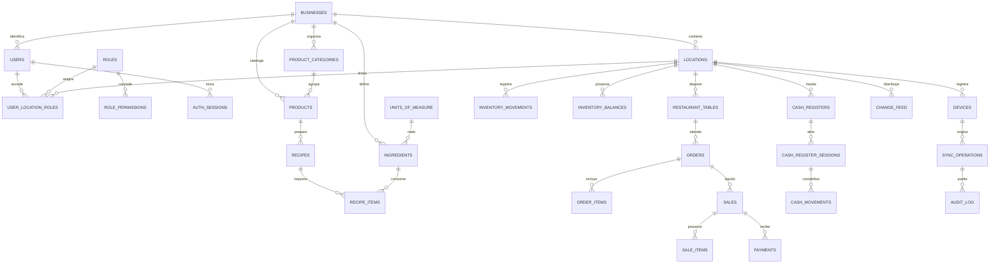

# Modelo Oracle inicial

Una instancia/esquema Oracle para todos los negocios. UUID en `VARCHAR2(36)`, fechas `TIMESTAMP WITH TIME ZONE`, JSON en CLOB con `IS JSON`, booleanos `NUMBER(1)` con CHECK. No se necesitan extensiones PostgreSQL. Dinero en centavos de COP: enteros `NUMBER(18,0)`, enviados como cadenas decimales para no perder precisión. Cantidades previstas `NUMBER(20,6)`; factores de conversión `NUMBER(24,9)`.

La migración 007 añade `user_location_permissions` (excepciones ALLOW/DENY por usuario, negocio, sucursal y permiso, con FK compuestas) y `administration_audit` (actor, acción, entidad y snapshots sin credenciales). El bloqueo individual prevalece sobre roles. Las mutaciones administrativas se serializan bloqueando la fila de negocio y confirman datos/accesos/auditoría/revocación juntos; no dependen de `sync_operations` de catálogo.

Toda entidad de sucursal incorpora `business_id` y `location_id`. Las FK compuestas impiden asociar un producto, mesa, usuario, sesión o dispositivo de otro ámbito. Catálogo, ingredientes y unidades son compartidos por negocio; precios y existencias específicos de sucursal se incorporan en fases posteriores. Los productos incluyen `version`; actualización requiere `base_version`.

`inventory_movements` es el ledger; `inventory_balances` es una proyección reconstruible. Costes históricos y coste/precio por línea de venta son snapshots. Una venta no se elimina: anulación/devolución crea compensaciones auditadas. El descuento se produce al cobrar, como hoy; editar una cuenta abierta no consume inventario. No se traduce `table_sessions` a una tabla de ventas: se separan ORDER y SALE.

## ERD

DDL base de identidad, catálogo y sincronización ejecutable en `database/migrations`, aplicado en orden y con checksum por el ejecutor automático. Cada archivo es un bloque PL/SQL único: copiar completo y ejecutar con el botón verde de Database Actions; incluye `COMMIT`. El formato utiliza SQL dinámico para que las nuevas tablas se creen antes de compilar sus INSERT. El ERD de dominios operativos guía migraciones posteriores. Oracle DDL hace commit implícito: si falla a mitad de un archivo, la ejecución se detiene y exige revisar/reparar ese archivo parcial antes de reintentar. El ROLLBACK del manejador solo afecta DML no confirmado; no revierte DDL ni oculta errores «objeto existente». Cambiar las definiciones de una migración aplicada detiene el ejecutor. Usar un único migrador y un esquema nuevo; no aplicar sobre Supabase ni importar backups de datos sin reconciliación. Si 001 ya se ejecutó manualmente con el formato anterior, continuar desde 002. Ver [ejecución manual y automática](deployment.md#copiar-pegar-y-ejecutar-en-database-actions).

El feed usa contador transaccional por sucursal con bloqueo `FOR UPDATE`; no usa una secuencia Oracle como cursor de commit. Todas las escrituras de catálogo sincronizadas y sus feed entries se confirman bajo ese bloqueo. Así un commit tardío no queda detrás de un cursor ya descargado.

## Ampliaciones diseñadas, aún no implementadas

Variantes/modificadores, compras/proveedores, conversiones compuestas, producción, pricing por sucursal, historial de costes detallado, terminales/impresoras, refunds, promociones, transferencias, notificaciones, QR/chat y reportes tienen lugar en el modelo pero no se crean tablas vacías para aparentar funcionalidad. Añadir migraciones incrementales cuando se implementen sus reglas.
